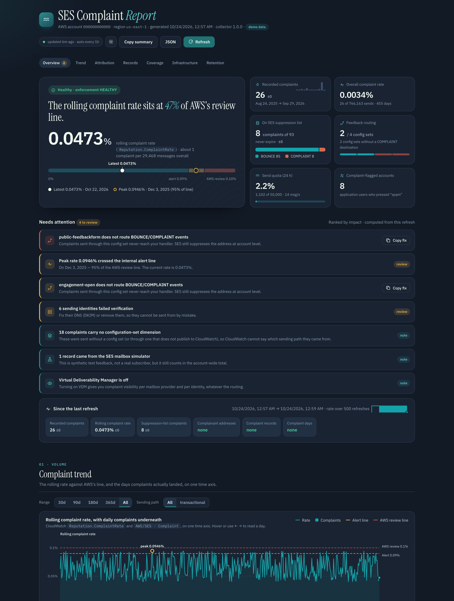

# SES Complaint Report

[](https://github.com/ryabinski-labs/ses-complaint-report/actions/workflows/codeql.yml)
[](https://scorecard.dev/viewer/?uri=github.com/ryabinski-labs/ses-complaint-report)
[](LICENSE)

**SES Complaint Report** is a self-hosted, refreshable dashboard for **Amazon SES
deliverability and complaint posture** in a single AWS account. Instead of a
one-shot HTML export, it is a page you can reopen, refresh against live AWS data, and search.

**Who it's for:** engineers and deliverability owners who operate SES sending
identities and need to watch bounce/complaint rates against AWS's enforcement
lines.

**The problem it solves:** SES complaint data is scattered across CloudWatch
metrics, the account-level suppression list, per-configuration-set event
destinations, SNS/SQS feedback plumbing, and whatever your application persisted.
This tool pulls it together into one view and keeps it current.

**Outcome:** a single localhost page showing complaint volume and rate vs the AWS
0.10% review line, who complained, what infra routes the feedback, and when the
data expires — refreshed on demand or hourly.



## Quickstart

```sh
git clone https://github.com/ryabinski-labs/ses-complaint-report
cd ses-complaint-report
cp .env.example .env        # edit for your profile/region
./start.sh                  # start in the background and open the browser
```

`./start.sh fg` runs in the foreground; `./start.sh stop`, `status`, and `logs`
manage a background instance.

## Install

Requirements: macOS or Linux, Python 3.10+ and [`uv`](https://docs.astral.sh/uv/).
No AWS account is needed to explore the UI in demo mode.

```sh
uv sync
```

## Try it without AWS

Demo mode serves a synthetic dataset, so you can see the whole report before
pointing it at an account:

```sh
SESREPORT_DEMO=1 uv run sesreport
```

## What it shows

- **Enforcement & suppression posture** — enforcement status, production access,
  account suppression and its live entry counts, VDM, send quota, dedicated-IP
  warm-up (`ses:GetAccount`).
- **Complaint volume** — complaint / send / bounce counts and the rolling
  `Reputation.ComplaintRate` vs the AWS 0.10% review line and an internal alert line.
- **Complaints by configuration set** — from the `ses:configuration-set` metric dimension.
- **Individual complaint records** — a unified, recipient-level view across every
  configured app store (address, store, feedback detail, source, first/last seen,
  hit count), with AWS **mailbox-simulator** (test) addresses flagged, plus the
  per-app account complainants and per-store counts.
- **Complaint attribution** — reconciles the account-wide CloudWatch complaint
  count against the recipient records each application store retained, separating
  real complainants from simulator/test artefacts.
- **Infrastructure map** — sending identities and DKIM status, configuration sets
  and their event destinations, identity-level Bounce/Complaint notification
  topics, SNS topics/subscribers, the complaint DLQ.
- **Retention & expiry** — CloudWatch's 455-day aging of complaint data points,
  the non-expiring SES suppression list, and the adaptive reputation window, with
  per-complaint expiry dates.
- **Suppression coverage** — every configuration set flagged as routing or **not**
  routing `BOUNCE`/`COMPLAINT`, risk-ranked, with a Markdown fix brief.
- **Mailbox providers (VDM-equivalent, VDM off)** — complaint, bounce, open and
  click rates per mailbox provider (Google, Microsoft, Yahoo, Apple… classified by
  recipient domain and MX), per sending identity and per configuration set, from
  the self-owned ledger. A rate appears once a row has 1,000 deliveries in the
  selected range. VDM itself stays off and costs nothing.
- **Advisor** — DKIM per identity, custom MAIL FROM and its SPF, DMARC presence and
  policy, complaint (0.08%/0.10%) and bounce (5%/10%) thresholds, and gaps in
  Delivery/Open/Click publishing. Every finding has a **Fix** button that copies an
  agent-ready Markdown brief (problem, steps, shell-quoted commands, verify,
  rollback) for you or a coding agent to apply.
- **Change tracking** — each refresh is snapshotted, so the report shows deltas
  (new complaints, rate movement, new complainant addresses) and a rate sparkline.

Every table supports search, sort, category filters, and CSV export; the charts
have a time-range picker and a per-config-set toggle. The whole report exports as
JSON, and a Markdown summary copies to the clipboard.

## Own your complaint state (ledger)

CloudWatch's `Complaint` metric is account-wide, keeps only 455 days, and
carries no dimension for sends made without a configuration set. VDM closes the
attribution gap but is priced per message. This repo instead deploys a
**self-owned ledger** you control:

- `infra/ledger-stack.yaml` — a DynamoDB table (`recipient_hash` partition key,
  `by_day` and `by_source` GSIs, TTL) plus an ingest Lambda subscribed to your
  SES feedback SNS topics. It writes one deduped, attributed row per
  bounce/complaint, keyed on the SHA-256 of the address with only a redacted
  address stored and a 13-month TTL.
- `infra/deploy_ledger.sh` — packages and deploys the stack, then subscribes the
  Lambda to your feedback topics (idempotent; re-run when you add a topic).

Point the report at it:

```sh
./infra/deploy_ledger.sh ses-complaint-report-ledger us-east-1 my-artifacts-bucket \
  my-app-ses-feedback,my-app-ses-bounces
# then set SESREPORT_LEDGER_TABLE=<table from the stack output> in .env
```

The topic names are passed on the command line (they are your account's, so they
stay out of the repo). Leave them off to deploy the table + Lambda first and wire
subscriptions later.

The Lambda also counts **Delivery, Open and Click** events into daily counter
items (recipient domain × sending identity × config set, no addresses; a 30-day
marker per SES message ID dedupes SNS redeliveries and repeat opens). Those
counters are the denominators for the Mailbox providers rates. To feed them,
publish the extra event types to the ledger's topics. The dashboard's Advisor
lists every config set and identity that does not, with a copyable fix brief:

- config sets: add `DELIVERY`, `OPEN` and `CLICK` to the SNS event destination
  (OPEN/CLICK make SES add a tracking pixel and rewrite links);
- identities used without a config set: `aws ses set-identity-notification-topic
  --notification-type Delivery`.

Redeploy the stack after upgrading so the Lambda has the counting code. At
~50,000 deliveries a month the added SNS/Lambda/DynamoDB cost is a few cents.

The report stays **read-only** — it reads the table; the Lambda is the only
writer. With the ledger configured, its recipient records become the primary
source of truth for attribution and survive past CloudWatch's window.

## When to use it (and when not to)

**Use it** to audit or monitor a single SES account's complaint posture, to find
which configuration sets and templates attract complaints, and to understand what
AWS would see when it reviews your account.

**Don't use it** as a multi-tenant or fleet-wide dashboard (it audits one account
per instance), as an alerting system (it displays; it doesn't page), or as a
write tool — the report process is strictly read-only against AWS. (The optional
ledger in `infra/` is a separate, opt-in writer; the report only reads it.)

## Requirements

- macOS or Linux, Python 3.10+ and [`uv`](https://docs.astral.sh/uv/).
- AWS credentials for the target account, via a profile in `~/.aws` (default: `default`).

### IAM permissions

Read-only. SES v1 and v2 API operations share the IAM service prefix `ses:`
(there is no `sesv2:` prefix):

```
sts:GetCallerIdentity
ses:GetAccount
ses:ListEmailIdentities, ses:GetEmailIdentity
ses:ListConfigurationSets, ses:DescribeConfigurationSet, ses:GetConfigurationSet
ses:ListSuppressedDestinations
ses:GetIdentityNotificationAttributes
cloudwatch:GetMetricStatistics
logs:DescribeLogGroups, logs:StartQuery, logs:GetQueryResults
sns:ListTopics, sns:ListSubscriptionsByTopic
sqs:GetQueueUrl, sqs:GetQueueAttributes
dynamodb:Scan            # the app tables named in .env, and the ledger table + its by_day index
dynamodb:Query           # the ledger table (daily delivery/open/click counters)
```

The Advisor also makes public DNS lookups (MX, TXT for SPF and DMARC) with a
2-second timeout, at most 120 per refresh, cached for 7 days. VDM APIs
(`BatchGetMetricData`, `ListRecommendations`) are never called.

## Configure

Copy `.env.example` to `.env` and edit:

| Variable | Meaning |
| --- | --- |
| `SESREPORT_PROFILE` | AWS profile to use |
| `SESREPORT_REGION` | Primary region being audited |
| `SESREPORT_EXTRA_REGIONS` | Extra regions summarised for identities |
| `SESREPORT_LOG_GROUPS` | Feedback log groups (blank = auto-discover) |
| `SESREPORT_LOG_GROUP_PREFIX` / `_MATCH` | Discovery prefix / substring |
| `SESREPORT_COMPLAINT_TABLE` | App table holding per-recipient complaint rows (blank = skip) |
| `SESREPORT_COMPLAINT_ATTR` / `_VALUE` | Filter attribute/value (default `bounce_type` = `Complaint`) |
| `SESREPORT_COMPLAINT_QUEUE` | Complaint DLQ name (blank = skip) |
| `SESREPORT_SUPPRESSION_TABLES` | Comma-separated app suppression tables to count |
| `SESREPORT_LEDGER_TABLE` | Self-owned complaint ledger table (see infra/); blank = fall back to CloudWatch + app stores |
| `SESREPORT_LEDGER_FUNCTION` | Ledger ingest Lambda name; an SNS topic with it subscribed counts as reaching the ledger (default `ses-complaint-report-ledger-ingest`) |
| `SESREPORT_APP_DKIM_PROJECTS` | `Project` tag values whose identities are DKIM-signed by the app, not SES (default `WebMail`) |
| `SESREPORT_APP_DKIM_MX` | MX hosts that mark a domain as app-signed when it predates tagging (default `inbound.wm.emcognito.com`) |
| `SESREPORT_TEST_IDENTITIES` | Identities that only send QA mail: their auth gaps are notes. Labels like `qa`, `test`, `staging`, `dev` (not the TLD) count automatically |
| `SESREPORT_ENGAGEMENT_TRACKING` | `true` makes missing OPEN/CLICK publishing a finding; off by default because tracking rewrites links |
| `SESREPORT_REDACT_EMAILS` | Mask recipient addresses in the API payload |
| `SESREPORT_DEMO` | Serve synthetic data instead of calling AWS |
| `SESREPORT_HOST`, `SESREPORT_PORT` | Local bind address (default `127.0.0.1:8787`) |
| `SESREPORT_ALLOWED_HOSTS` | Extra `Host` names to serve besides loopback; other hosts get 400 (DNS-rebinding guard) |
| `SESREPORT_DATA_DIR` | Cache and history directory (default `src/sesreport/data`, or `src/sesreport/data/demo` in demo mode) |
| `SESREPORT_REFRESH_SECONDS` | Background refresh interval (default 3600) |
| `SESREPORT_HISTORY_MAX` | Refresh snapshots kept for change tracking (default 500) |

The DynamoDB sections are app-specific; leave their variables blank and they are
skipped cleanly. The account ID is read from `sts:GetCallerIdentity`.

> The report reads recipient addresses from application stores. Those are kept
> out of the collector's output directory (`src/sesreport/data/` is gitignored)
> and are never sent anywhere — the dashboard is bound to localhost. Set
> `SESREPORT_REDACT_EMAILS=true` when screenshotting or sharing.

## HTTP API

| Method | Path | Purpose |
| --- | --- | --- |
| `GET` | `/` | The interactive report |
| `GET` | `/api/report` | Latest collected model (JSON); `202` while collecting |
| `GET` | `/api/status` | Refresh state, last run, errors, interval |
| `GET` | `/api/history` | Snapshot history for change detection |
| `POST` | `/api/refresh` | Trigger a live re-query (returns immediately) |

## Development

```sh
uv sync
uv run python -m sesreport.collect     # run the collector and print JSON
uv run ruff check . && uv run pytest    # lint + smoke tests (no AWS calls)
uv run sesreport                       # start the server
cd tests/ui && npm ci && npx playwright test   # browser E2E (demo mode, no AWS calls)
```

## Support

Best-effort, community support. Open a GitHub issue for bugs or questions; see
[SUPPORT.md](SUPPORT.md). Report security issues privately per
[SECURITY.md](SECURITY.md). How the project is run is described in
[GOVERNANCE.md](GOVERNANCE.md).

## License

[MIT](LICENSE) © 2026 Yoni Ryabinski.
